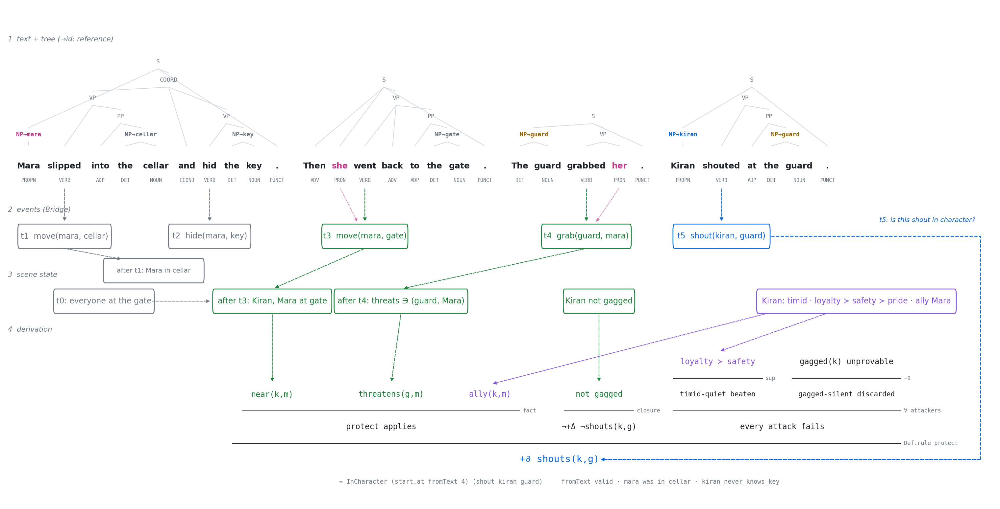

<h1 align="center">StoryLangLib: Checking Stories in Lean</h1>

Idea: let an LLM write the prose, and let Lean check that the text says what
the model claims it says and that the story it tells has no plot holes.

StoryLangLib is a Lean 4 library in two halves. The first half encodes
English text as typed trees (Universal Dependencies parts of speech, phrase
structure, entity references) whose leaves must render back to exactly the
tokens of the source, so an LLM's annotation of a passage can be checked
rather than trusted. The second half reads events off those trees into a
modular story world (places, minds, relationships, a magic system, whatever
the story needs) where validity is decidable: who knows what, who could be
where, whether an action is in character, whether there was consent, and
whether the timeline the text describes is consistent.

<p align="center"></p>

A passage, its checked annotation, the events read off it, the scene facts
they produce, and the derivation that Kiran's shout is in character. Every
dashed line is a step the code performs.

## Example

An LLM encodes a passage as a langlib document; `langlib check` accepts it
only if its leaves are the source's tokens and its references resolve:

```
$ langlib check examples/cata.txt bad.json
 "edits":
 ["token 2 \"finally\" is missing (near: When she finally walked in ,)",
  "token 10 \"him\" was written as \"her\" (near: Kiran didn't look at him . \" Sit)"],
 "refIssues":
 ["pronoun \"her\" (token 9) refers to \"marcus\", whose pronouns are he"],
```

Story worlds are assembled from modules, and stories about them are theorems:

```lean
abbrev E := SpaceEv Ch Pl Ob ⊕ MindEv Ch Fact ⊕ SocialEv Ch

def told : List E :=
  [ so (.confide marcus kiran), so (.flirt marcus kiran), so (.flirt kiran marcus),
    sp (.take mara letter),                                 -- meanwhile, in the office
    so (.ask marcus kiran .kiss), so (.agree kiran marcus .kiss),
    so (.agree marcus kiran .kiss), so (.act kiran marcus .kiss),
    sp (.drop marcus letter), sp (.move marcus roof) ]      -- flashback

theorem story_valid : story.Valid start := by decide +kernel
theorem marcus_false_belief :
    falseBelief ends marcus (fact (.objAt letter office)) = true := by decide +kernel
theorem kiss_needs_consent : ¬ Valid start noConsent := by decide +kernel
```

When a step fails, the checker says why, in terms a writer (or the model) can
act on:

```
out of character (shy people hold back); to justify it, first establish:
attraction draws them on or the confident make the first move
```

## Building

The project is a plain Lake package:

```
lake build
```

This checks every theorem in the examples. The command-line tool ends up in
`.lake/build/bin/langlib`:

```
langlib tokenize <text>             print tokens
langlib check <text> <doc.json>     check an encoding against its text
langlib render <doc.json>           print the text a document renders to
langlib pretty <doc.json>           print bracketed trees
```

## Evaluation

`eval/` asks models to encode 20 passages (Austen, Melville, Doyle, Twain,
Stoker, Dickinson, Shelley, Fitzgerald, and four from kirancodes.me), feeding
the checker's report back for up to three rounds:

```
cd eval
python3 build_corpus.py
python3 run_eval.py --models haiku,sonnet,opus,fable --jobs 12
python3 analyze.py
```

| model  | right first time | right within 3 tries |
|:-------|:-----------------|:---------------------|
| Opus   | 90%              | 100%                 |
| Fable  | 90% (95% flat)   | 100%                 |
| Sonnet | 80% (95% flat)   | 100%                 |
| Haiku  | 35%              | 55%                  |

Full results, including tree agreement between models and a reference check
with TypeSafe's Jev, are in `docs/eval-results.md`.

## Project structure
```
.
|-- LangLib
|   |-- Basic.lean, Token.lean, Render.lean, Json.lean, Diff.lean, Refs.lean, Check.lean
|   |-- Story
|   |   |-- DL.lean
|   |   |-- Bridge.lean
|   |   `-- Scene.lean, GateScene.lean, GateText.lean
|   `-- World
|       |-- Time.lean, Domain.lean, Persona.lean
|       |-- Space.lean, Mind.lean, Social.lean, Magic.lean
|       |-- Lexicon.lean
|       `-- Examples        Office, OfficeText, Gossip, Mage
|-- Main.lean
|-- examples
|-- eval
|-- viz
`-- docs
```

| Path                  | Description                                                                 |
|-----------------------|-----------------------------------------------------------------------------|
| LangLib/Basic.lean    | Words, phrases, entities, topics: the typed encoding of a text              |
| LangLib/Token.lean    | The tokenizer both the source and every leaf are cut by                     |
| LangLib/Check.lean    | The faithfulness check: token diff, bad leaves, reference issues            |
| LangLib/Refs.lean     | Mentions, pronoun agreement, anaphora and cataphora                         |
| LangLib/Story/DL.lean | Defeasible logic as inductive relations, coherence, checked certificates    |
| LangLib/Story/Bridge  | Clauses (verb, subject, object, obliques) read off a checked document       |
| LangLib/Story/Scene*  | The first, single-file scene model (the gate scene), kept as a worked case  |
| LangLib/World/Time    | Allen interval relations, durations, an untrusted solver, timelines as consistency certificates |
| LangLib/World/Domain  | Composable story semantics: `Domain`, `Valid`, stories told out of order    |
| LangLib/World/Persona | Traits, ranked values, and in-character checks via defeasible logic         |
| LangLib/World/Space   | Places, objects, possession, what each event lets witnesses see             |
| LangLib/World/Mind    | Beliefs with provenance, lore (Horn rules), nested views, consistency, revision and rejection of hearsay, witnessing, telling, lying |
| LangLib/World/Social  | Trust, attraction, affection, tension; consent as a hard precondition       |
| LangLib/World/Magic   | An example story-specific module: spells and mana                           |
| LangLib/World/Lexicon | Verb lexicons per module; adverbials ("meanwhile", "an hour earlier") to time constraints |
| eval                  | Corpus, model runner, analysis, Jev reference check                         |
| viz                   | Scripts for the figures in `viz/out`                                        |
| docs                  | Literature reviews (linguistic encoding, story logic) and results           |

## Requirements

| Package        | Version  | Notes                                       |
|:---------------|:---------|:--------------------------------------------|
| Lean           | 4.35.0   | via `lean-toolchain`; no Mathlib needed     |
| Python         | ≥ 3.10   | only for `eval` and `viz`                   |
| claude CLI     |          | `eval/run_eval.py` calls models through it  |
| graphviz       |          | `viz` figures                               |
| matplotlib     |          | `viz` figures                               |
| JEV_API_KEY    |          | optional, `eval/jev_coref.py`               |

From text to theorem: `examples/office.txt` was annotated by Opus, accepted by
`langlib check`, read by the space and relationship lexicons into the office
story (flashback "an hour earlier", a "meanwhile"), timed by the solver, and
proved valid (`LangLib/World/Examples/OfficeText.lean`).

## Status

Work in progress. Open next: lexicon coverage beyond the example verbs,
character rules for more actions, and a loop that sends checker failures back
to the writing model.
